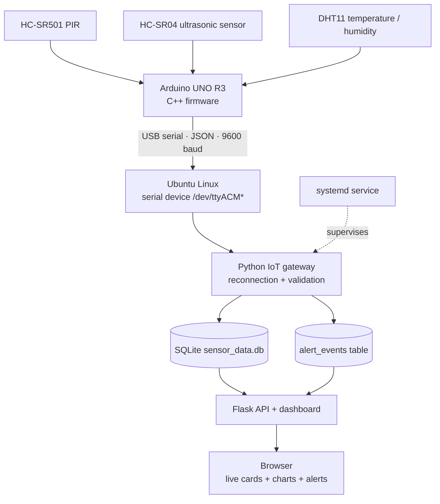
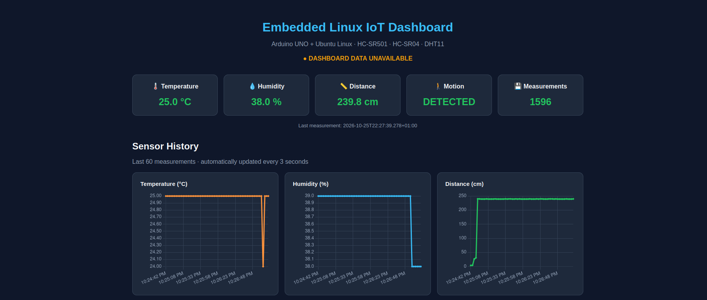
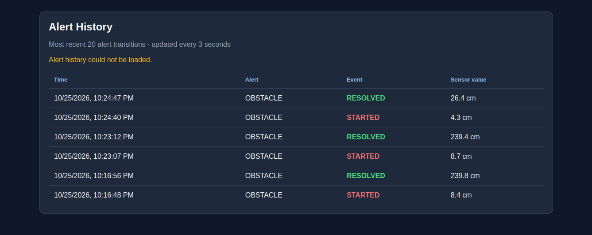

# Embedded Linux IoT Monitoring Gateway

**Arduino UNO R3 · Ubuntu Linux · Embedded C++ · Python · USB Serial · SQLite · Flask · systemd**

A working prototype of an IoT edge-monitoring system combining microcontroller firmware with a Linux monitoring gateway. An Arduino UNO collects motion, distance, temperature, and humidity readings; an Ubuntu application validates and stores the data, handles USB reconnection, and provides a browser-based dashboard with history charts and alerts.

> **Architecture note:** The gateway was developed on Ubuntu running inside VirtualBox on a PC. This is an embedded-device-to-Linux gateway project, **not** a native Embedded Linux board or Linux kernel-driver project.

## Features

- Reads an **HC-SR501 PIR** motion sensor, **HC-SR04** ultrasonic distance sensor, and **DHT11** temperature/humidity module.
- Sends newline-delimited JSON over USB serial at **9600 baud**.
- Discovers the Arduino USB device and retries after disconnections.
- Validates incoming messages and persists readings in **SQLite**.
- Runs the gateway as a **systemd** background service on Ubuntu.
- Displays live measurements, last-update/data-freshness status, and historical charts in a **Flask** dashboard.
- Records obstacle-alert **STARTED** and **RESOLVED** transitions in SQLite and displays recent alert history.
- Includes an obstacle warning when a fresh distance reading is **20 cm or less**; high-temperature warning logic uses **30°C** as its configured threshold.

## System architecture



## Hardware

| Component | Arduino UNO connection |
| --- | --- |
| HC-SR501 PIR — VCC / OUT / GND | 5V / D2 / GND |
| HC-SR04 — VCC / TRIG / ECHO / GND | 5V / D12 / D11 / GND |
| DHT11 **3-pin module** — S / + / − | D3 / 5V / GND |
| Arduino UNO | USB connection to Ubuntu host/VM |

Use common 5V and GND breadboard rails. **Disconnect USB power before rewiring.** Check the labels printed on your individual modules before connecting them.

## Repository layout

```text
Embedded-IoT-Portfolio/
├── firmware/
│   └── Embedded_IoT_Monitor/
│       └── Embedded_IoT_Monitor.ino
├── linux/
│   ├── iot_gateway.py
│   ├── dashboard.py
│   ├── requirements.txt
│   └── embedded-iot-gateway.service
├── docs/
└── .gitignore
```

## Serial message format

The Arduino sends one JSON object per line, approximately every 2.5 seconds:

```json
{"pir":1,"distance_cm":16.7,"temperature":25,"humidity":34}
```

- `pir`: `1` if the PIR output is HIGH, otherwise `0`.
- `distance_cm`: measured distance in centimeters, or `null` if no valid echo is received.
- `temperature`: degrees Celsius, or `null` on a DHT11 read failure.
- `humidity`: relative humidity percentage, or `null` on a DHT11 read failure.

## Running the project on Ubuntu

### 1. Upload Arduino firmware

Install the **SimpleDHT** Arduino library and upload `firmware/Embedded_IoT_Monitor/Embedded_IoT_Monitor.ino` using Arduino IDE. Connect the sensors according to the wiring table above.

If Ubuntu runs in VirtualBox, attach the Arduino using **Devices → USB** after uploading. Only one operating system can own the USB device at a time.

### 2. Install Linux dependencies

On Ubuntu:

```bash
sudo apt update
sudo apt install python3-flask python3-serial
sudo usermod -aG dialout "$USER"
```

Log out and back in if group membership was changed. Confirm the Arduino appears with:

```bash
lsusb
ls /dev/ttyACM* /dev/ttyUSB* 2>/dev/null
```

Alternatively, use a Python virtual environment and install packages from `linux/requirements.txt`.

### 3. Test manually

From the repository root, in the first terminal:

```bash
cd linux
python3 iot_gateway.py
```

In a **second** terminal:

```bash
cd linux
python3 dashboard.py
```

Open **http://127.0.0.1:5000** in a browser **inside Ubuntu**. The dashboard is bound to the local machine. Charts load Chart.js from a CDN, so Internet access is needed unless that dependency is hosted locally.

**Do not run the manual gateway and the systemd gateway simultaneously:** both would attempt to read the same Arduino serial port.

### 4. Run the gateway with systemd (optional)

The included unit is an **example configuration captured from the development VM**. Before installing it, edit `User=`, `WorkingDirectory=`, and `ExecStart=` to match **your** Ubuntu username and the absolute path of **your cloned repository**. For example, the working directory should point to the clone's `linux/` folder, not someone else's home directory.

Then:

```bash
sudo cp linux/embedded-iot-gateway.service /etc/systemd/system/
sudo systemctl daemon-reload
sudo systemctl enable --now embedded-iot-gateway.service
systemctl status embedded-iot-gateway.service
journalctl -u embedded-iot-gateway.service -f
```

To stop the gateway before uploading different firmware:

```bash
sudo systemctl stop embedded-iot-gateway.service
```

## Dashboard/API

| Endpoint | Purpose |
| --- | --- |
| `/` | Live measurement cards, data freshness, alerts and charts |
| `/api/status` | Latest measurement and freshness/alert status |
| `/api/history` | Recent sensor measurements for charts |
| `/api/alerts` | Recent stored alert transitions |

Add a screenshot of the working dashboard to `docs/dashboard.png` and reference it here once uploaded.

## Testing performed

- Read motion, distance, temperature and humidity from real sensors.
- Verified JSON reception in Ubuntu via USB serial.
- Verified SQLite inserts and SQL queries.
- Disconnected and reattached the Arduino: the gateway reconnected and resumed saving data.
- Verified the dashboard switched between **LIVE** and **NO RECENT SENSOR DATA** based on recent measurements.
- Verified obstacle-alert **STARTED** and **RESOLVED** entries in the `alert_events` table.

**Remaining improvements:** automated unit/integration tests, long-duration soak testing, local hosting of Chart.js, improved sensor diagnostics, and confirming high-temperature alert transitions using controlled test data.

## Limitations and safety

This is a learning and demonstration prototype, not a certified industrial safety or security system. The DHT11 is a low-cost, relatively low-resolution sensor. USB disconnection may result in missing samples because the Arduino does not buffer or replay measurements. A recent database timestamp indicates **data freshness**, not a guaranteed physical device-health check. The Flask development server should not be exposed publicly.
## Dashboard



## Alert Monitoring


## Credits

Built as an independent extension of the ELEGOO Arduino starter-kit sensor exercises, adding a Linux gateway, service management, persistent data storage, dashboard, and alert logging.
